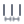

# 5. Restricciones

Las relaciones geométricas que el solver mantiene siempre: horizontal, paralela, tangente, coincidente y las demás, con su numeración en el dibujo.

[← 4. Dividir, copiar y repetir](04-dividir-copiar-y-repetir.md) · [Índice](README.md) · [6. Cotas →](06-cotas.md)

---

Selecciona los elementos y pulsa el botón. Cada botón indica qué selección necesita.

## Horizontal / Vertical

 **Horizontal** y  **Vertical** se aplican a líneas, o a 2 puntos.

## Distribuir ↔ / Distribuir ↕

  **Distribuir ↔ / Distribuir ↕** se aplican a 3 o más puntos o textos (un texto, por su punto de inserción).

**Resultado.** Quedan **igualmente espaciados** en horizontal (x) o en vertical (y), entre los dos de los extremos (el de más a la izquierda y el de más a la derecha, o el de más abajo y el de más arriba), que no se mueven al aplicarla.

**La otra coordenada.** Queda libre: para alinearlos además, usa Horizontal o Vertical.

**Comportamiento.** Es una restricción como las demás: la separación es una incógnita, así que si arrastras un extremo los de en medio se reparten de nuevo, y si arrastras uno de en medio se mueven todos.

**Rótulo.** Se rotula ↔1, ↕1 junto a cada punto.

## Paralela / Perpendicular

 **Paralela** y  **Perpendicular** se aplican a 2 o más líneas.

## Coincidente

 **Coincidente** admite tres selecciones:

- **2 o más puntos:** quedan en el mismo lugar.
- **Punto(s) y 1 línea, arco, círculo, elipse o spline:** los puntos quedan sobre el elemento.
- **Líneas o arcos y 1 elipse o spline:** el extremo más cercano de cada línea o arco queda sobre la curva.

 **Colineal**: 2 o más líneas.

## Punto medio

 **Punto medio** se aplica a 1 punto + 1 línea.

## Concéntrica (◎)

 **Concéntrica** se aplica a 2 o más círculos o arcos.

**Cuál manda.** El centro del primero manda y los demás centros coinciden con él.

**Si ya coinciden.** Si ya comparten el centro, avisa y no agrega nada.

## Igual

 **Igual** se aplica a 2 líneas (igual longitud) o a 2 círculos/arcos (igual radio).

**Redondeo y chaflán.** Al redondear o achaflanar una esquina, la igualdad de longitudes de las líneas que se acortan pasa a ser una igualdad de distancias entre su otro extremo y el vértice virtual de la esquina (se ve como «=» junto a esos puntos).

## Tangente

 **Tangente** admite estas selecciones:

- Línea + círculo/arco.
- 2 círculos/arcos.
- Un spline con una línea, círculo o arco.
- Una **elipse** (o arco elíptico) con una línea, círculo o arco.
- 2 elipses.

Con elipses y splines aparece el punto de contacto.

## Fijar / soltar

 **Fijar / soltar** se aplica a puntos, líneas o círculos.

**Efecto.** Un punto fijo no se mueve al arrastrar.

## Marca de referencia

**Marca de referencia** (propiedades de un punto, **Marca de referencia en** y la línea): una marca **no es un punto fijo**.

### Cómo funciona

El solver no la mueve mientras resuelve, pero después de cada cambio se **proyecta sobre su línea**, que ya está en su nueva posición y orientación. Así se desliza sola a lo largo de la línea, arrastrada por ella, y **recuerda lo recorrido**: la distancia entre la marca y otro punto de la línea acumula el camino.

**Frente a una cota de posición.** Una cota de posición no puede hacerlo, porque vuelve al mismo valor al cerrar un recorrido; la marca sí.

**Aspecto.** Se dibuja como una **x**.

### Reiniciar marcas

 **Reiniciar marcas** (botón del grupo Spline, o **Reiniciar** en las propiedades del punto) devuelve cada marca a su *referencia*: la distancia sobre la línea, desde su primer extremo, que tenía al asignarla.

**Para qué sirve.** Sirve para colocar el mecanismo en otro lugar y empezar la lectura de nuevo desde cero.

**Tomar la actual.** **Tomar la actual** cambia la referencia.

### Usos

Sirve para rieles, ruedas que ruedan sobre una línea que gira y planímetros.

**Ejemplo, el planímetro polar.** El polo y el brazo con el trazador P siguen el contorno de una figura; el riel (perpendicular al brazo) pasa por P y lleva una marca.

- D = distancia de la marca a P (solo lectura).
- El giro de la rueda es `(D-D0)/(O1/2)`.
- El área es `longitud del brazo × radio × giro`.

### Reglas y límite

- Una marca pertenece a una sola línea y no puede ser extremo de ella.
- Si se borra la línea, deja de ser marca.
- Las copias y matrices la reasignan a la copia de su línea.

**Límite.** La marca avanza por pasos (cada resolución), así que el recorrido acumulado tiene un error que baja con arrastres más finos (en el planímetro, 2 a 4 % con arrastre normal).

## Indicadores

Cada relación se rotula con su letra y número junto a los elementos que involucra (los mismos número y letra en todos).

- **Un punto con una línea, un círculo o un arco:** junto al punto y al elemento.
- **Una horizontal o vertical entre 2 puntos:** junto a los dos.
- **Engranaje:** se marcan con **G**.
-  **[Cremallera](09-simulaciones-graficas.md#cremallera):** las de rueda y cremallera se marcan con **Cr**.

## Restricciones redundantes

 Una restricción redundante no agrega información (otras ya implican lo mismo) y hace más lento cada cálculo, porque el solver resuelve dos veces y las diagnostica.

**Quitarlas.** El botón **Redundantes** (grupo Restricciones) las lista y ofrece quitarlas; al abrir un archivo que las tenga aparece un aviso.

**Cotas con nombre.** Las cotas con nombre no se quitan solas (pueden alimentar fórmulas).

## Numeración

Cada restricción lleva un número por tipo (H1, H2, ⟂1, ∥1, =1, ●1, T1...).

**Varios elementos.** Las que involucran varios elementos comparten un solo número y se rotulan junto a cada elemento (por ejemplo, dos líneas perpendiculares muestran ⟂1 cada una).

**Reutilización.** El número no se reutiliza si borras la restricción.

**Árbol de elementos.** En el [árbol de elementos](10-estilo-capas-y-vista.md#árbol-de-elementos) cada restricción aparece con su número: tócala para seleccionarla junto con sus elementos y llevar el lienzo hasta ahí.

**Automáticas.** Las restricciones automáticas que ponen un punto sobre un elemento al dibujar (●) no se rotulan.

**Contradicciones.** Si una restricción contradice a las demás, la app avisa y deshace la acción.

---

[← 4. Dividir, copiar y repetir](04-dividir-copiar-y-repetir.md) · [Índice](README.md) · [6. Cotas →](06-cotas.md)
