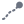

# 8. Splines y trazados (levas y trayectorias)

Curvas libres que pasan por puntos del dibujo, la trayectoria de un punto que se mueve y las curvas equidistantes, base de levas y trayectorias.

[← 7. Texto y cálculo](07-texto-y-calculo.md) · [Índice](README.md) · [9. Simulaciones gráficas →](09-simulaciones-graficas.md)

---

Un spline es un **B-spline cúbico** que pasa por puntos reales del dibujo.

- **Abierto:** curvatura nula en los extremos.
- **Cerrado:** periódico, suave en toda la vuelta, sin esquina en la unión.

Esos puntos se comportan como puntos libres hasta que los restrinjas.

## Es un elemento de primera clase

Puede tener puntos sobre él, intersecciones y tangencias con líneas, círculos y arcos.

El solver las resuelve de forma exacta, no aproximada, junto con el resto del dibujo.

## Deformación

Arrastrar un punto del spline, o un punto ligado a él, deforma la curva y el resto del dibujo sigue.

**Seguidor.** Un seguidor (punto sobre el spline y sobre una recta, por ejemplo) recorre el perfil mientras mueves la recta.

- Un punto ligado a un spline **abierto** no puede salirse de sus extremos: si lo intentas, la app avisa de un conflicto y deshace.
- Al soltar un arrastre, un spline con relaciones recalcula sus parámetros internos para que no ondule si los puntos se movieron mucho; puede cambiar ligeramente de forma.

## Botón Spline

 **Botón Spline** (barra): toca para dibujar un spline.

**Desplegable.** Toca de nuevo o mantén presionado para abrir el [desplegable](desplegables.md#spline-y-trazados), que trae:

- Trazar punto
- Borrar trayectoria
- Trazado a spline
- Cerrar o abrir
- Equidistante

**Datos que pide.** Trazado a spline y Equidistante te piden el número de puntos o la distancia al usarlos.

## Trazar punto

 **Trazar punto** hace que un punto dibuje su trayectoria al mover el mecanismo.

**Trazado a spline.**  **Trazado a spline** convierte la trayectoria (la primera vuelta) en un spline editable.

## Equidistante

 **Equidistante** es una curva paralela a un spline a una distancia dada (por ejemplo el radio del rodillo de una leva).

Avisa si la distancia supera el radio de curvatura.

## Cerrar / abrir

 **Cerrar / abrir** el spline seleccionado.

En el SVG de corte y en el DXF salen como curvas exactas.

## Forma fija de un spline

**Forma fija de un spline** (propiedades del spline) amarra sus puntos de control entre sí con distancias ocultas.

**Efecto.** La curva se mueve y gira como un cuerpo rígido y **no se deforma** cuando algo arrastra uno de sus puntos (por ejemplo, el perfil de un diente de engranaje que gira con su rueda).

**Desmarcar.** Se desmarca para volver a editar la curva punto por punto.

**Con matrices.** Úsala antes de copiar el spline en una matriz.

---

[← 7. Texto y cálculo](07-texto-y-calculo.md) · [Índice](README.md) · [9. Simulaciones gráficas →](09-simulaciones-graficas.md)
