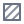

# 10. Estilo, capas y vista

Color, tipo de línea, grosor y rellenos; capas; lo que muestra la vista; y el árbol de elementos.

[← 9. Simulaciones gráficas](09-simulaciones-graficas.md) · [Índice](README.md) · [11. Archivo y exportación →](11-archivo-y-exportacion.md)

---

## Estilo

 **Estilo** define el color, el tipo de línea y el grosor. Aplica a la selección y a lo nuevo.

- **Color.**
- **Tipo de línea:** continua, oculta, eje, fantasma, discontinua, punteada, traza y punto, o uno nuevo con su patrón.
- **Grosor:** fino, normal, grueso.

**Selección mixta.** Cada propiedad cambia solo los elementos a los que aplica: el color llega a líneas, textos y rellenos; el tipo de línea y el grosor, a los gráficos (líneas, círculos, arcos, elipses, splines, líneas indicativas y trazados), no al texto ni al relleno; la **fuente** y la **altura** (filas que aparecen cuando hay un texto seleccionado), solo a los textos. Las filas que no sirven a lo seleccionado se ven atenuadas. Si los elementos tienen valores distintos, el control dice «(varios)» y solo cambia lo que tú elijas.

## Relleno / achurado

 **Relleno / achurado** se aplica sobre un contorno cerrado (líneas, arcos o círculo).

Puede ser de líneas, cruzado o sólido, con ángulo, separación y opacidad.

## Capas

 **Capas** (esquina superior izquierda del dibujo) abre la lista de capas.

Al principio no hay ninguna y lo que dibujas no pertenece a ninguna capa.

### Crear, elegir y borrar

- **Crear capa:** la hace la **capa actual** (círculo marcado). Lo que dibujes después, incluidos puntos, textos y rellenos, queda en ella.
- **Ninguna:** la fila «Ninguna» vuelve a dibujar sin capa.
- **Borrar:** el bote **borra** la capa y sus elementos pasan a «ninguna».
- **Renombrar:** puedes renombrarla en su fila.
- **Nombre en pantalla:** cuando hay una **capa actual**, su nombre aparece bajo el botón Capas.

### Apagar y encender

El ojo **apaga o enciende** la capa.

Apagada, sus elementos, los puntos que solo ellos usan y sus restricciones y cotas no se ven, no se seleccionan, no cortan al [recortar o extender](03-seleccionar-y-editar.md#recortar-x) y no se exportan. Siguen existiendo y el solver los respeta.

Apagar la capa actual la deja sin capa actual.

### Cambiar la capa de un elemento

Para cambiar la capa de un elemento, toca dos veces sobre él.

Copiar y pegar, dividir y recortar conservan la capa del original.

### Cotas y líneas indicativas

Las **cotas** y las **líneas indicativas** también tienen capa: la actual al crearlas, y se cambia en su ventana, con doble toque.

Con la capa apagada no se ven ni se exportan, pero una cota sigue midiendo o mandando con su fórmula, por ejemplo la que mueve una pieza desde un cálculo.

## Vista

 **Vista** reúne estas opciones:

- **Cuadrícula.**
- **Imán** (a la cuadrícula).
- **Bloqueo suave** (y cada cuántos grados).
- **Tiempo del imán** a intersecciones.
- **Mostrar u ocultar** restricciones, puntos, cotas y textos.
- **Dedo dibuja.**
- **Etiquetas del panel.**
- **Escala de los trazos.**

**Versión y build.** En la esquina inferior izquierda del dibujo se ve en cursiva la **versión de la app y su build**, el commit desde el que se compiló (por ejemplo *v1.6.1 7bc0108*; con «+» si tenía cambios sin commitear), para saber exactamente qué compilación corre cada dispositivo.

**Archivo actual.** En la esquina superior derecha se ve el **nombre del archivo actual** (o «sin nombre»).

## Árbol de elementos

 **Árbol de elementos** (primer botón de la barra) lista líneas, círculos, arcos, splines, textos, rellenos, puntos y relaciones.

Toca un elemento para seleccionarlo y ver sus puntos y restricciones.

### Un solo lugar para cada cosa

Cada cosa tiene un solo lugar propio.

**Puntos.** Un punto vive en el primer elemento que lo usa (los centros, en su círculo) y en los demás aparece como enlace *↗* («↗ Punto p1 (en Círculo c2)»). En «Puntos sueltos» solo quedan los que no son de ningún elemento.

**Enlaces.** Tocar un enlace selecciona el elemento y abre su lugar propio.

### Relaciones y cotas

Las relaciones viven en «Relaciones y cotas», separadas en Cotas, Geométricas, Mecánicas y Automáticas.

**Automáticas.** Se agrupan por la operación que las creó, numerada en el orden en que se hizo («Matriz circular 2», «Redondeo 1», «Copia espejo 1», «Chaflán», «División», «Polígono»), y las de formas fijas y vectores por su elemento.

**Sin origen.** Las que no tienen origen (dibujos hechos antes de esta versión, o las que pone el imán al dibujar sobre un elemento) se agrupan por tipo.

**Por elemento.** Bajo cada elemento hay una sola fila «Relaciones (n)» con enlaces a las suyas y a las de sus puntos, que además cuenta las automáticas.

### Agrupar por capa

Si el dibujo tiene capas, el botón de capas del encabezado agrupa el árbol **por capa**.

Primero va cada capa (también las vacías), con su ojo para encenderla o apagarla, y dentro de ella los mismos grupos por tipo. Luego «Sin capa» y las relaciones, actuadores, gráficas y trazados, que no tienen capa.

Un punto sigue a su elemento aunque esté en otra capa.

### Contornos

El grupo **Contornos** junta las líneas y arcos de trazo (no constructivos), arcos elípticos y splines abiertas encadenados por sus extremos: «Contorno 2 · cerrado · 4 líneas, 2 arcos» (cerrado, abierto o ramificado si en un nudo se juntan tres o más).

**Cuándo se tocan dos extremos.** Dos extremos se tocan si son el mismo punto, si los ata una [coincidencia](05-restricciones.md#coincidente) o si están en el mismo lugar sin nada que los ate. Esas se avisan («1 unión sin restricción»), porque al mover el dibujo se pueden abrir; para atarlas, pon una coincidencia.

**Seleccionar.** Tocar un contorno selecciona todos sus elementos; dentro van como enlaces, en el orden en que se recorren.

**Abertura.** Si un extremo libre queda cerca de otro (hasta el 1 % del tamaño del dibujo), el contorno dice cuánto mide esa **abertura** y con qué contorno («abertura 0.0143 con el 2»), o «entre sus extremos» si casi se cierra solo. Es la razón típica de que un perfil que debería ser cerrado salga abierto.

### Agrupar un contorno

Un contorno detectado se puede **agrupar**: el botón *Agrupar en un contorno* de su fila crea un **grupo de contorno** (`k1`, `k2`…) con sus elementos. También puedes seleccionar elementos de trazo y usar el botón de agrupar del encabezado del árbol.

Un grupo es una declaración tuya: sus líneas y arcos pasan a vivir **bajo él**, en «Contornos» (y salen de «Líneas» y «Arcos»), con todo lo suyo. La fila dice su estado, que se mide cada vez: «cerrado», «abierto · abertura 0.05 entre sus extremos», o «desconectado (2 partes)» si los miembros no forman una cadena. Puedes agrupar elementos aunque no estén conectados y mirar luego el estado.

- Tocar el grupo selecciona todos sus elementos.
- **Disolver** (*Disolver el contorno*): los elementos se quedan donde estaban, sin grupo, y vuelven a «Líneas» y «Arcos».
- **Borrar** (la papelera): borra el grupo **y** sus elementos.
- Un elemento está en un solo grupo. Un círculo, un vector, un elemento constructivo o una spline cerrada no entran.
- Copiar, pegar y las matrices **no** copian el grupo; dividir un elemento deja los trozos en el grupo. Si un grupo se queda con menos de dos elementos, desaparece solo.

---

[← 9. Simulaciones gráficas](09-simulaciones-graficas.md) · [Índice](README.md) · [11. Archivo y exportación →](11-archivo-y-exportacion.md)
