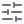

# Botones desplegables

Todos los grupos de herramientas de la barra, con lo que trae cada uno y dónde se explica cada herramienta.

[← 1. Empezar](01-empezar.md) · [Índice](README.md) · [2. Dibujar →](02-dibujar.md)

---

## Cómo funcionan

Los botones con una esquina marcada son **desplegables**: muestran la última herramienta usada del grupo.

Toca la esquina, vuelve a tocar el botón cuando ya está activo, o mantenlo presionado para ver las demás.

Algunos elementos de un desplegable no son herramientas sino **acciones**: se ejecutan al tocarlos y no quedan activos (por ejemplo, Filtrar, Guardar o Cerrar / abrir el spline).

Si no encuentras un botón, toca su ícono en la ayuda: la ayuda se cierra, el desplegable se abre y el botón se resalta (ver [Ayuda y búsqueda](01-empezar.md#ayuda-y-búsqueda)).

## Los grupos de un vistazo

| Grupo | Contiene |
|---|---|
| [Seleccionar](#seleccionar) | Seleccionar y Filtrar |
| [Línea](#línea) | Línea, Vector, Línea de punto medio y Línea constructiva |
| [Círculo](#círculo) | Círculo, Círculo perimetral y Círculo constructivo |
| [Arco](#arco) | Arco por centro y extremos, Arco por 3 puntos y los dos constructivos |
| [Elipse](#elipse) | Elipse y Elipse parcial |
| [Rectángulo](#rectángulo) | Rectángulo por diagonal y Rectángulo de centro |
| [Spline y trazados](#spline-y-trazados) | Spline, trayectorias de un punto, cerrar o abrir y equidistante |
| [Redondeo y chaflán](#redondeo-y-chaflán) | Redondeo y Chaflán |
| [Copiar y pegar](#copiar-y-pegar) | Copiar y Pegar |
| [Actuadores y simulación](#actuadores-y-simulación) | Actuador MR, Actuador ML, Gráfica y Simulación |
| [Archivo](#archivo) | Guardar, abrir, GitHub, insertar, datos y exportar |

## Seleccionar

-  **Seleccionar y arrastrar (V)**: ver [Seleccionar (V)](03-seleccionar-y-editar.md#seleccionar-v).
-  **Filtrar la selección…**: elige qué se puede seleccionar. Es una acción. Ver [Filtrar](03-seleccionar-y-editar.md#filtrar).

## Línea

-  **Línea (L)**: ver [Línea (L)](02-dibujar.md#línea-l).
-  **Vector (W)**: una línea con cabeza de flecha y magnitud. Con una línea seleccionada, la convierte en vector. Ver [Vector (W)](02-dibujar.md#vector-w).
-  **Línea de punto medio (M)**: ver [Línea de punto medio (M)](02-dibujar.md#línea-de-punto-medio-m).
-  **Línea constructiva (K)**: ver [Línea constructiva (K)](02-dibujar.md#línea-constructiva-k).

## Círculo

-  **Círculo (C)**: ver [Círculo (C)](02-dibujar.md#círculo-c).
-  **Círculo perimetral (3 puntos)**: ver [Círculo perimetral](02-dibujar.md#círculo-perimetral).
-  **Círculo constructivo**: ver [Círculo y arcos constructivos](02-dibujar.md#círculo-y-arcos-constructivos).

## Arco

-  **Arco por centro y extremos (R)**: ver [Arco por centro y extremos (R)](02-dibujar.md#arco-por-centro-y-extremos-r).
-  **Arco por 3 puntos (A)**: ver [Arco por 3 puntos (A)](02-dibujar.md#arco-por-3-puntos-a).
-  **Arco constructivo por centro y extremos** y  **Arco constructivo por 3 puntos**: ver [Círculo y arcos constructivos](02-dibujar.md#círculo-y-arcos-constructivos).

## Elipse

-  **Elipse: centro y dos ejes (O)**: ver [Elipse (O)](02-dibujar.md#elipse-o).
-  **Elipse parcial (arco elíptico)**: ver [Elipse parcial](02-dibujar.md#elipse-parcial).

## Rectángulo

-  **Rectángulo por diagonal (B)**: ver [Rectángulo (B)](02-dibujar.md#rectángulo-b).
-  **Rectángulo de centro**: ver [Rectángulo de centro](02-dibujar.md#rectángulo-de-centro).

## Spline y trazados

-  **Spline por puntos (S)**: ver [Spline (S)](02-dibujar.md#spline-s).
-  **Trazar punto (activar o quitar)**: ver [Trazar punto](08-splines-y-trazados.md#trazar-punto).
-  **Borrar trayectoria**: ver [Botón Spline](08-splines-y-trazados.md#botón-spline).
-  **Reiniciar marcas**: ver [Reiniciar marcas](05-restricciones.md#reiniciar-marcas).
-  **Trazado a spline…**: convierte una trayectoria en un spline. Ver [Trazar punto](08-splines-y-trazados.md#trazar-punto).
-  **Cerrar o abrir el spline**: ver [Cerrar / abrir](08-splines-y-trazados.md#cerrar--abrir).
-  **Equidistante…**: ver [Equidistante](08-splines-y-trazados.md#equidistante).

## Redondeo y chaflán

-  **Redondeo (F)**: toca una esquina, o dos elementos, y teclea el radio.
-  **Chaflán**: toca una esquina y teclea la distancia.

Los dos se explican en [Redondeo (F) y Chaflán](03-seleccionar-y-editar.md#redondeo-f-y-chaflán).

## Copiar y pegar

-  **Copiar la selección (Ctrl+C)**. Es una acción.
-  **Pegar (Ctrl+V)**: toca el punto donde va el centro de lo copiado.

Ver [Copiar / Pegar](03-seleccionar-y-editar.md#copiar--pegar).

## Actuadores y simulación

-  **Actuador MR**: ver [MR (rotacional)](09-simulaciones-graficas.md#mr-rotacional).
-  **Actuador ML**: ver [ML (lineal)](09-simulaciones-graficas.md#ml-lineal).
-  **Gráfica**: ver [Gráficas](09-simulaciones-graficas.md#gráficas).
-  **Simulación**: ver [Simulación](09-simulaciones-graficas.md#simulación).

## Archivo

El botón **Archivo** solo abre el desplegable: no ejecuta nada por sí mismo. Todo lo que trae es una acción.

-  **Nuevo dibujo**,  **Guardar (.json)** y  **Abrir…**: ver [Guardar / Abrir](11-archivo-y-exportacion.md#guardar--abrir).
-  **Guardar en GitHub…**,  **Abrir de GitHub…** y  **Configurar GitHub…**: ver [GitHub](11-archivo-y-exportacion.md#github).
-  **Insertar imagen…**: ver [Imágenes](03-seleccionar-y-editar.md#imágenes).
-  **Insertar biblioteca…**: ver [Bibliotecas](09-simulaciones-graficas.md#bibliotecas).
-  **Datos…**: ver [Datos del dispositivo](11-archivo-y-exportacion.md#datos-del-dispositivo).
-  **Exportar PNG**,  **Exportar SVG** y  **Exportar DXF**: ver [PNG, SVG y DXF](11-archivo-y-exportacion.md#png).
-  **SVG para corte láser…**: ver [SVG CUT](11-archivo-y-exportacion.md#svg-cut).

---

[← 1. Empezar](01-empezar.md) · [Índice](README.md) · [2. Dibujar →](02-dibujar.md)
