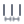
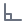
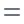

<!-- es: f83c4b5b91 -->
# 5. Constraints

The geometric relations the solver always maintains: horizontal, parallel, tangent, coincident and the rest, with their numbering in the drawing.

[← 4. Splitting, copying and repeating](04-dividir-copiar-y-repetir.md) · [Index](README.md) · [6. Dimensions →](06-cotas.md)

---

Select the elements and press the button. Each button states what selection it needs.

## Horizontal / Vertical

 **Horizontal** and  **Vertical** apply to lines, or to 2 points.

## Distribute ↔ / Distribute ↕

  **Distribute ↔ / Distribute ↕** apply to 3 or more points or texts (a text, by its insertion point).

**Result.** They end up **evenly spaced** horizontally (x) or vertically (y), between the two at the ends (the leftmost and the rightmost, or the lowest and the highest), which do not move when you apply it.

**The other coordinate.** It stays free: to align them as well, use Horizontal or Vertical.

**Behavior.** It is a constraint like the others: the spacing is an unknown, so if you drag an end point the ones in between are spread out again, and if you drag one in between they all move.

**Label.** It is labeled ↔1, ↕1 next to each point.

## Parallel / Perpendicular

 **Parallel** and  **Perpendicular** apply to 2 or more lines.

## Coincident

 **Coincident** accepts three selections:

- **2 or more points:** they end up in the same place.
- **Point(s) and 1 line, arc, circle, ellipse or spline:** the points end up on the element.
- **Lines or arcs and 1 ellipse or spline:** the nearest end of each line or arc ends up on the curve.

 **Collinear**: 2 or more lines.

## Midpoint

 **Midpoint** applies to 1 point + 1 line.

## Concentric (◎)

 **Concentric** applies to 2 or more circles or arcs.

**Which one governs.** The center of the first one governs and the other centers coincide with it.

**If they already coincide.** If they already share the center, you are warned and nothing is added.

## Equal

 **Equal** applies to 2 lines (equal length) or to 2 circles/arcs (equal radius).

**Fillet and chamfer.** When you fillet or chamfer a corner, the length equality of the lines that get shortened becomes an equality of distances between their other end and the virtual vertex of the corner (it shows as "=" next to those points).

## Tangent

 **Tangent** accepts these selections:

- Line + circle/arc.
- 2 circles/arcs.
- A spline with a line, circle or arc.
- An **ellipse** (or elliptical arc) with a line, circle or arc.
- 2 ellipses.

With ellipses and splines the contact point appears.

## Fix / release

 **Fix / release** applies to points, lines or circles.

**Effect.** A fixed point does not move when you drag.

## Reference mark

**Reference mark** (properties of a point, **Reference mark at** and the line): a mark **is not a fixed point**.

### How it works

The solver does not move it while solving, but after each change it is **projected onto its line**, which is already in its new position and orientation. This way it slides along the line by itself, carried by it, and **remembers the distance traveled**: the distance between the mark and another point on the line accumulates the path.

**Versus a position dimension.** A position dimension cannot do this, because it returns to the same value when a trip is closed; the mark can.

**Appearance.** It is drawn as an **x**.

### Reset marks

 **Reset marks** (button in the Spline group, or **Reset** in the point's properties) returns each mark to its *reference*: the distance along the line, from its first end, that it had when it was assigned.

**What it is for.** It is useful for placing the mechanism somewhere else and starting the reading again from zero.

**Take the current one.** **Take the current one** changes the reference.

### Uses

It is useful for rails, wheels that roll on a rotating line and planimeters.

**Example, the polar planimeter.** The pole and the arm with the tracer P follow the outline of a figure; the rail (perpendicular to the arm) passes through P and carries a mark.

- D = distance from the mark to P (read-only).
- The wheel's rotation is `(D-D0)/(O1/2)`.
- The area is `arm length × radius × rotation`.

### Rules and limit

- A mark belongs to a single line and cannot be an end of it.
- If the line is deleted, it stops being a mark.
- Copies and arrays reassign it to the copy of its line.

**Limit.** The mark advances in steps (each solve), so the accumulated travel has an error that decreases with finer drags (in the planimeter, 2 to 4 % with a normal drag).

## Indicators

Each relation is labeled with its letter and number next to the elements it involves (the same number and letter on all of them).

- **A point with a line, circle or arc:** next to the point and the element.
- **A horizontal or vertical between 2 points:** next to both.
- **Gear:** marked with **G**.
-  **[Rack](09-simulaciones-graficas.md#rack):** wheel-and-rack ones are marked with **Cr**.

## Redundant constraints

 A redundant constraint adds no information (others already imply the same thing) and slows down every calculation, because the solver solves twice and diagnoses them.

**Removing them.** The **Redundant** button (Constraints group) lists them and offers to remove them; when you open a file that has them, a notice appears.

**Named dimensions.** Named dimensions are not removed automatically (they may feed formulas).

**If something will not move.** If you drag something and nothing moves because the solver finds no solution with the current relations, a notice says so and names the relations whose removal unblocks it (removing one is enough). A typical case: a tangency between two pieces of the same ellipse, which are almost the same curve.

## Numbering

Each constraint carries a number per type (H1, H2, ⟂1, ∥1, =1, ●1, T1...).

**Several elements.** Those that involve several elements share a single number and are labeled next to each element (for example, two perpendicular lines each show ⟂1).

**Reuse.** The number is not reused if you delete the constraint.

**Element tree.** In the [element tree](10-estilo-capas-y-vista.md#element-tree) each constraint appears with its number: tap it to select it together with its elements and bring the canvas to it.

**Automatic ones.** The automatic constraints that place a point on an element while drawing (●) are not labeled.

**Contradictions.** If a constraint contradicts the others, the app warns you and undoes the action.

---

[← 4. Splitting, copying and repeating](04-dividir-copiar-y-repetir.md) · [Index](README.md) · [6. Dimensions →](06-cotas.md)
