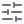

<!-- es: c58a668aad -->
# Dropdown buttons

Every tool group in the toolbar, with what each one contains and where each tool is explained.

[← 1. Getting started](01-empezar.md) · [Index](README.md) · [2. Drawing →](02-dibujar.md)

---

## How they work

Buttons with a marked corner are **dropdowns**: they show the last tool used from the group.

Tap the corner, tap the button again when it is already active, or press and hold it to see the others.

Some items in a dropdown are not tools but **actions**: they run when you tap them and do not stay active (for example, Filter, Save or Close / open the spline).

If you cannot find a button, tap its icon in the help: the help closes, the dropdown opens and the button is highlighted (see [Help and search](01-empezar.md#help-and-search)).

## The groups at a glance

| Group | Contains |
|---|---|
| [Select](#select) | Select and Filter |
| [Line](#line) | Line, Vector, Midpoint line and Construction line |
| [Circle](#circle) | Circle, Circle through 3 points and Construction circle |
| [Arc](#arc) | Arc by center and ends, Arc by 3 points and the two construction ones |
| [Ellipse](#ellipse) | Ellipse and Partial ellipse |
| [Rectangle](#rectangle) | Rectangle by diagonal and Center rectangle |
| [Spline and paths](#spline-and-paths) | Spline, paths of a point, close or open and offset |
| [Fillet and chamfer](#fillet-and-chamfer) | Fillet and Chamfer |
| [Copy and paste](#copy-and-paste) | Copy and Paste |
| [Actuators and simulation](#actuators-and-simulation) | MR actuator, ML actuator, Graph and Simulation |
| [File](#file) | Save, open, GitHub, insert, data and export |

## Select

-  **Select and drag (V)**: see [Select (V)](03-seleccionar-y-editar.md#select-v).
-  **Filter the selection…**: chooses what can be selected. It is an action. See [Filter](03-seleccionar-y-editar.md#filter).

## Line

-  **Line (L)**: see [Line (L)](02-dibujar.md#line-l).
-  **Vector (W)**: a line with an arrowhead and a magnitude. With a line selected, it turns it into a vector. See [Vector (W)](02-dibujar.md#vector-w).
-  **Midpoint line (M)**: see [Midpoint line (M)](02-dibujar.md#midpoint-line-m).
-  **Construction line (K)**: see [Construction line (K)](02-dibujar.md#construction-line-k).

## Circle

-  **Circle (C)**: see [Circle (C)](02-dibujar.md#circle-c).
-  **Circle through 3 points**: see [Circle through 3 points](02-dibujar.md#circle-through-3-points).
-  **Construction circle**: see [Construction circle and arcs](02-dibujar.md#construction-circle-and-arcs).

## Arc

-  **Arc by center and ends (R)**: see [Arc by center and ends (R)](02-dibujar.md#arc-by-center-and-ends-r).
-  **Arc by 3 points (A)**: see [Arc by 3 points (A)](02-dibujar.md#arc-by-3-points-a).
-  **Construction arc by center and ends** and  **Construction arc by 3 points**: see [Construction circle and arcs](02-dibujar.md#construction-circle-and-arcs).

## Ellipse

-  **Ellipse: center and two axes (O)**: see [Ellipse (O)](02-dibujar.md#ellipse-o).
-  **Partial ellipse (elliptical arc)**: see [Partial ellipse](02-dibujar.md#partial-ellipse).

## Rectangle

-  **Rectangle by diagonal (B)**: see [Rectangle (B)](02-dibujar.md#rectangle-b).
-  **Center rectangle**: see [Center rectangle](02-dibujar.md#center-rectangle).

## Spline and paths

-  **Spline through points (S)**: see [Spline (S)](02-dibujar.md#spline-s).
-  **Trace point (turn on or remove)**: see [Trace point](08-splines-y-trazados.md#trace-point).
-  **Delete path**: see [Spline button](08-splines-y-trazados.md#spline-button).
-  **Reset marks**: see [Reset marks](05-restricciones.md#reset-marks).
-  **Path to spline…**: turns a path into a spline. See [Trace point](08-splines-y-trazados.md#trace-point).
-  **Close or open the spline**: see [Close / open](08-splines-y-trazados.md#close--open).
-  **Offset…**: see [Offset](08-splines-y-trazados.md#offset).

## Fillet and chamfer

-  **Fillet (F)**: tap a corner, or two elements, and type the radius.
-  **Chamfer**: tap a corner and type the distance.

Both are explained in [Fillet (F) and Chamfer](03-seleccionar-y-editar.md#fillet-f-and-chamfer).

## Copy and paste

-  **Copy the selection (Ctrl+C)**. It is an action.
-  **Paste (Ctrl+V)**: tap the point where the center of what you copied goes.

See [Copy / Paste](03-seleccionar-y-editar.md#copy--paste).

## Actuators and simulation

-  **MR actuator**: see [MR (rotary)](09-simulaciones-graficas.md#mr-rotary).
-  **ML actuator**: see [ML (linear)](09-simulaciones-graficas.md#ml-linear).
-  **Graph**: see [Graphs](09-simulaciones-graficas.md#graphs).
-  **Simulation**: see [Simulation](09-simulaciones-graficas.md#simulation).

## File

The **File** button only opens the dropdown: it does not run anything by itself. Everything in it is an action.

-  **New drawing**,  **Save (.json)** and  **Open…**: see [Save / Open](11-archivo-y-exportacion.md#save--open).
-  **Save to GitHub…**,  **Open from GitHub…** and  **Set up GitHub…**: see [GitHub](11-archivo-y-exportacion.md#github).
-  **Insert image…**: see [Images](03-seleccionar-y-editar.md#images).
-  **Insert library…**: see [Libraries](09-simulaciones-graficas.md#libraries).
-  **Data…**: see [Device data](11-archivo-y-exportacion.md#device-data).
-  **Export PNG**,  **Export SVG** and  **Export DXF**: see [PNG, SVG and DXF](11-archivo-y-exportacion.md#png).
-  **SVG for laser cutting…**: see [SVG CUT](11-archivo-y-exportacion.md#svg-cut).

---

[← 1. Getting started](01-empezar.md) · [Index](README.md) · [2. Drawing →](02-dibujar.md)
